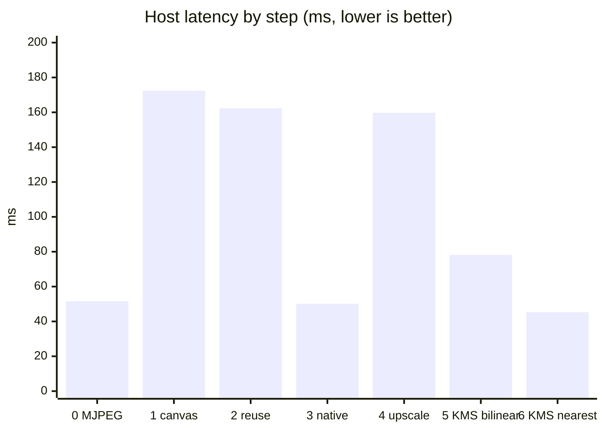

# Real-time person & face detection with depth on the Kria KV260

An Intel RealSense D455 feeds an INT8 **YOLOv26n** detector running on the
KV260's DPU. Every detected **person** and **face** gets a distance in metres,
and the annotated video is delivered to a browser, a Raspberry Pi, or straight to
a 1080p monitor. The C++ pipeline reaches the camera's full **30 FPS** with ~45 ms
host latency while using a third of the CPU.

The main engineering result is the fullscreen 1920x1080 display path. Measured on
the board, it went from **8.7 FPS / 172 ms / 77 % CPU** to **29.5 FPS / 45 ms / 33 % CPU**
in six measured steps, by finding and removing one bottleneck at a time
([details below](#performance-optimisation-at-1920x1080)).

| | Start (X11, letterbox canvas) | End (DRM/KMS, word-level nearest) | Change |
|---|---|---|---|
| Output FPS | 8.7 | 29.5 | 3.4× |
| Host latency (mean) | 172 ms | 45 ms | 3.8× lower |
| CPU load | 77 % | 33 % | 2.3× lower |

## Contents

- [Hardware](#hardware) · [Repository layout](#repository-layout) · [Workflow](#workflow)
- [Architecture](#architecture) · [Output modes](#output-modes)
- [Performance optimisation at 1920x1080](#performance-optimisation-at-1920x1080)
- [Other findings](#other-findings) · [Earlier work](#earlier-work) · [Tests](#tests) · [Limitations](#limitations)

## Hardware

| Part | Detail |
|------|--------|
| Board | AMD/Xilinx Kria KV260 (Zynq UltraScale+ MPSoC, 4× Cortex-A53), PetaLinux 2022.2, kernel 5.15.36 |
| Accelerator | DPU `DPUCZDX8G_ISA1_B4096`, 1 core @ 300 MHz, Vitis AI 3.0 (VART / XIR) |
| Camera | Intel RealSense D455 (stereo depth + RGB), USB 3 (5000 Mbit/s) |
| Display | Samsung S24D300, 1920x1080 over DisplayPort (zynqmp DPSUB) |
| Model | YOLOv26n, 2 classes (Person, Human face), INT8, 640x640 input; compiled outside this repo |

**D455 streams used.** The camera offers colour up to 1280x800@30 and depth up to
1280x720@30 (depth also 848x480@90 and 424x240@90; colour 848x480@60 — full list with
`--list-profiles`). The application uses:

| Stream | Profile | Why |
|--------|---------|-----|
| RGB | **848x480 @ 30 FPS**, YUYV (native) → BGR8 | enough resolution for a 640x640 model input, low USB and conversion cost |
| Depth | **424x240 @ 30 FPS**, Z16 | smallest depth profile at the colour frame rate; depth is only sampled at a few points per detection |

Depth is **not** aligned to the colour frame. For each box the app samples a 5x5 grid
over its central 35 %, maps those points into the raw depth image with the
camera intrinsics/extrinsics, and takes the median (valid range 0.1 – 10 m). The early
Python tests aligned the whole frame; the sparse mapping replaced that.

The camera runs through librealsense's **RSUSB** backend, not the kernel UVC path:
the default backend triggered a kernel Oops in `uvc_stop_streaming()` when the
pipeline stopped ([`docs/realsense-rsusb.md`](docs/realsense-rsusb.md)).

## Repository layout

```
inference/
├── yolov26/                 ← the main application
│   ├── core/                shared: camera, letterbox, INT8, DPU runner, decode, depth, overlay
│   ├── mjpeg/               browser output                           (README)
│   ├── rpi/                 Raspberry Pi H.264/RTP + Redis           (README)
│   └── hdmi/                local monitor, X11 or DRM/KMS            (README)
└── densebox/                first DPU experiment, frozen             (README)
scripts/                     build scripts, launchers, mock sender    (README: catalogue of every script)
tools/camera_bringup/        Python camera diagnostics                (README)
tests/                       host-side tests, mirrors inference/yolov26 (README)
docs/                        RSUSB backend notes, performance logs
models/                      placeholder; .xmodel files are not committed
build/                       compiled binaries (git-ignored)
```

Per-mode guides: [overview](inference/yolov26/README.md) ·
[mjpeg](inference/yolov26/mjpeg/README.md) · [rpi](inference/yolov26/rpi/README.md) ·
[hdmi (X11 + KMS)](inference/yolov26/hdmi/README.md) ·
[scripts](scripts/README.md) · [camera tools](tools/camera_bringup/README.md) ·
[tests](tests/README.md).

## Workflow

```
 train / export YOLOv26n  →  quantize + compile for the B4096 DPU  →  yolov26n_facehuman_kria.xmodel
        (outside this repo)                (Vitis AI 3.0)                       │
                                                                                ▼
 sh scripts/build_live_yolov26_hdmi.sh   →   ./build/live_yolov26_hdmi --model <xmodel> --renderer kms
   (on the KV260, g++ + pkg-config)                  (or the mjpeg / rpi build and binary)
```

1. **Camera:** install librealsense with the RSUSB backend ([`docs/realsense-rsusb.md`](docs/realsense-rsusb.md)). Check it with `python3 tools/camera_bringup/camera_test.py`.
2. **Model:** copy the compiled xmodel to the board (e.g. `/home/root/models/`). It must match the
   [model contract](inference/yolov26/README.md#model-contract); arbitrary YOLO exports are not supported.
3. **Build** the mode you want from the repository root: `sh scripts/build_live_yolov26.sh`
   (browser), `…_rpi.sh` (Pi), or `…_hdmi.sh` (monitor). Binaries land in `build/`.
4. **Run**, with `--telemetry true` to see FPS, per-stage times and CPU:

```sh
# Browser: open http://KV260_IP:8081/
./build/live_yolov26_realsense --model /home/root/models/yolov26n_facehuman_kria.xmodel

# Local monitor, lowest latency (stop X first so the app can own the display)
systemctl stop xserver-nodm
./build/live_yolov26_hdmi --renderer kms --model /home/root/models/yolov26n_facehuman_kria.xmodel
```

## Architecture

```
RealSense D455 ─ USB3 ─ librealsense (RSUSB)
   colour 848x480@30 ───────────────┐          depth 424x240@30 (raw Z16)
                                    ▼                          │
                      letterbox 640x640 (RGB, pad 114)         │
                      INT8 quantize (256-entry LUT)            │
                                    ▼                          │
                      DPU, one subgraph, 6 output tensors      │
                      (box + class at strides 8/16/32)         │
                                    ▼                          │
                      decode (REG_MAX=1 LTRB, no NMS)          │
                                    ▼                          ▼
                          boxes + classes ──► 5x5 depth grid → median distance
                                    │
            ┌───────────────────────┴───────────────────────┐
            │ capture thread                                │
            └───────────────► capacity-1 latest-frame handoff ◄── newer frame replaces a pending one
                                    ▼
            output thread: annotate →  MJPEG │ H.264/RTP + Redis │ HDMI X11 │ HDMI KMS
```

Design points:

- **Two threads with a capacity-1 handoff.** Capture + DPU + depth never wait for the display.
  If the output is slower, the pending frame is replaced, so latency stays bounded and the
  cost appears as dropped frames, not a growing queue.
- **Direct VART.** The app loads the xmodel through XIR/VART `RunnerExt`, validates the
  tensor contract at startup, and does preprocessing and decoding itself.
- **No NMS.** The one2one YOLOv26 head produces non-duplicated boxes, so decoding is
  just thresholding and sorting.
- **One core, several outputs.** All modes share `inference/yolov26/core`; each mode adds
  only its own delivery code.

## Output modes

| Mode | Binary | Output | Guide |
|------|--------|--------|-------|
| **mjpeg** | `live_yolov26_realsense` | HTTP MJPEG for a browser (port 8081) | [mjpeg](inference/yolov26/mjpeg/README.md) |
| **rpi** | `live_yolov26_rpi` | H.264/RTP/UDP video to a Raspberry Pi + independent Redis `face_detected` status | [rpi](inference/yolov26/rpi/README.md) |
| **hdmi, X11** | `live_yolov26_hdmi` | OpenCV/GTK window on the board's X desktop | [hdmi](inference/yolov26/hdmi/README.md#x11-backend) |
| **hdmi, KMS** | `live_yolov26_hdmi --renderer kms` | Direct DRM scan-out, no X | [hdmi](inference/yolov26/hdmi/README.md#kms-backend) |

## Performance optimisation at 1920x1080

**Goal:** show the annotated stream fullscreen on a 1080p monitor at the camera's 30 FPS.

**Setup.** Everything below is the same hardware, model (640x640 INT8, DPU ≈ 11 ms per
frame, ≈ 90 FPS capacity), camera profile (848x480@30) and telemetry, measured with
`--telemetry true`. Each step was built from the commit that introduced it and run for
35 s; the first 5 s are dropped. 30 FPS is the camera's ceiling.
**Latency is host pipeline latency** (frame request → handed to the display), not
glass-to-glass. Method, caveats and raw logs: [`docs/performance/`](docs/performance/README.md).

| # | Step | FPS | Latency mean (ms) | CPU % | Notes |
|---|------|----:|------------------:|------:|-------|
| 0 | MJPEG to a browser (reference, no local display) | 29.6 | 51.6 | 36 | camera-limited |
| 1 | X11, new 1920x1080 canvas every frame, then resize + copy | 8.7 | 172.4 | 77 | **display-bound** |
| 2 | + reuse the canvas, `waitKey(1)` | 9.7 | 162.3 | 79 | no real change |
| 3 | X11, `imshow` the 848x480 frame as-is (native-size window) | 29.4 | 50.1 | 52 | fast, but not fullscreen |
| 4 | X11, aspect-fit upscale to 1080p | 9.7 | 159.7 | 77 | display-bound again |
| 5 | KMS, software bilinear scale into the scan-out buffer | 29.2 | 78.2 | 65 | camera-rate, high latency |
| 6 | KMS, nearest-neighbour at 16/32-bit word level | **29.5** | **45.3** | **33** | **final** |



### What was the bottleneck, and what we did

**Steps 1 → 2: the display, not inference.** At 8.7 FPS the frame period is 115 ms, yet
preprocessing (24 ms) + DPU (12 ms) + depth (1 ms) add up to only ~37 ms. The rest is the
GUI loop: every frame allocated a 1920x1080x3 canvas (6.2 MB), resized the camera frame
into it and pushed it to the X server. That version has no per-stage display timer, so
this is inferred from the frame budget. Reusing the canvas and polling faster (step 2)
changed FPS by ~1 and CPU not at all: **allocation was not the cost.**

**Step 3: payload size.** Showing the 848x480 frame (1.2 MB) directly, with no canvas, resize
or copy, restored 29.4 FPS and halved CPU. So the cost scales with the pixels pushed
through OpenCV's GTK/`XPutImage` path. But OpenCV 4.5.2's GTK backend draws at natural size,
so this is a small window, not a fullscreen picture.

**Step 4: fullscreen brings it back.** Scaling to 1920x1080 on the A53 and sending 6.2 MB per
frame through X returned to 9.7 FPS. The same code reached ~30 FPS earlier only because
the monitor was in a 1024x768 mode, where the upscaled frame was 1024x580 (3.5× fewer pixels). **At 1080p, X11 cannot reach camera rate here.**
This is why the earlier results had to be re-measured at 1080p.

**Dead end: hardware scaling.** The first KMS attempt assumed the DisplayPort subsystem's video
layer would scale 848x480 to 1080p. It showed a black screen: the ZynqMP DPSUB has **no
scaler**, both layers must share one source size, and the driver logged
`Layer width:height must be 1920:1080` and skipped the layer. Early numbers from that
version were discarded. The fix was to give the DPSUB buffers of the full
mode size and do the scaling in software.

**Step 5: remove X, keep the scaling.** Writing straight into DRM dumb buffers removes
GTK and X and reaches 29.2 FPS. But the bilinear resize to 1080p costs ~30 ms per frame on
the A53 (`show` = 30.0 ms), which keeps CPU at 65 % and latency at 78 ms.

**Step 6: cheaper scaling.** Convert the frame to the scan-out pixel format at native
size (848x480), then upscale by nearest-neighbour copying whole 16/32-bit words. `show`
dropped 30.0 → 7.1 ms, CPU 65 → 33 %, latency 78 → 45 ms. It is now **camera-limited and
as cheap as the browser stream** (33 % vs 36 % CPU; 45 ms vs 52 ms, measured to different end points: display hand-over vs completed send). Nearest-neighbour is blockier than
bilinear; `--kms-scaling linear` keeps the smoother option.

**Where the time goes now (step 6, per frame):** the capture thread spends 18.6 ms on
preprocessing (CPU letterbox + quantize), 11.1 ms in the DPU and ~4 ms acquiring, about 34 ms
in total against the camera's 33 ms frame period. The display side (3.0 ms wait, 1.4 ms draw,
7.1 ms show) runs on the other thread and has headroom. So the camera and the capture thread
are now the limit, and the largest remaining cost is CPU preprocessing, not the DPU. Going
beyond 30 FPS (the D455 offers 848x480@60) would first need faster preprocessing.

## Other findings

- **Detection flicker came from quantization, not the display.** In a 45 s stationary test, the
  class-head outputs have coarse fixed-point scales (0.25 logit steps at stride 8, 1.0 at
  strides 16/32), so person scores sit on a few discrete levels (0.731 / 0.500 / 0.269) and a
  0.30 threshold acts like 0.5. Lowering the threshold to 0.25 raised person presence from 66 %
  to 97 % of frames and cut flips from 272 to 50, with no extra false boxes. Face dropouts are
  real model misses. Options: lower the threshold, add temporal hysteresis, or re-quantize the
  class heads.
- **Sparse depth instead of alignment.** Mapping 25 points per detection avoids aligning every
  depth frame to colour.
- **RSUSB backend** avoids the kernel Oops on pipeline stop.

## Earlier work

**DenseBox** was the first DPU experiment: the stock Vitis AI face detector, used to prove
camera → DPU → overlay → browser worked at all. It is kept for reference and is not developed
further ([`inference/densebox`](inference/densebox/README.md)). The **camera scripts** in
[`tools/camera_bringup`](tools/camera_bringup/README.md) are the original bring-up diagnostics.

## Tests

```sh
python3 -m unittest discover -s tests
```

Host-side tests cover option parsing, geometry, frame composition, scheduling, launchers,
build scripts and the Pi wire contract against fixtures: 110 tests, 2 skipped on a PC without
the board's libraries ([`tests/README.md`](tests/README.md)). Camera, DPU and monitor
behaviour is verified manually on the board.

## Limitations

- Compiled models are not included, and training/quantization tooling is outside this repo.
- Latency is host pipeline latency, not camera-to-photon.
- The 1080p study is one board, one run per step, an uncontrolled scene.
- KMS mode needs exclusive DRM access, so the X desktop must be stopped.
- The Pi video receiver and Redis server are maintained outside this repository; Redis has no
  AUTH/TLS and must be on a private network.
